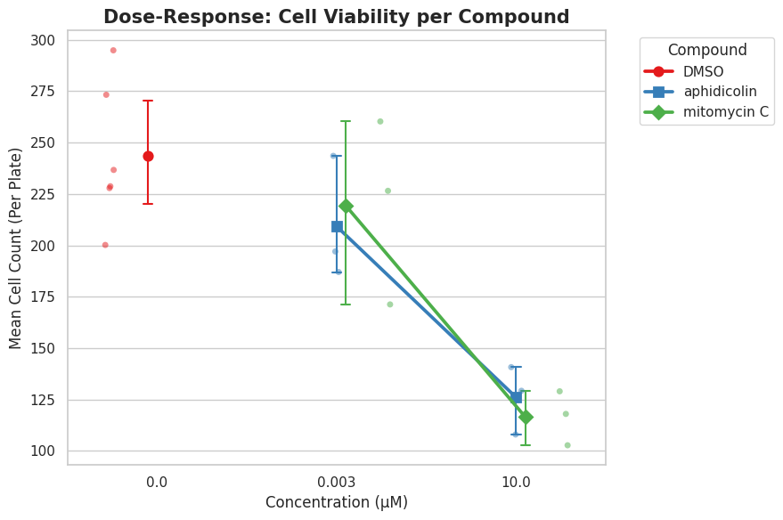
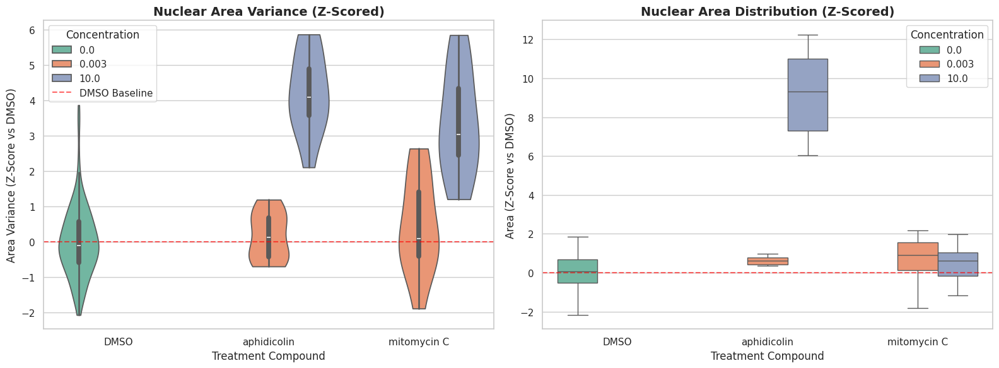
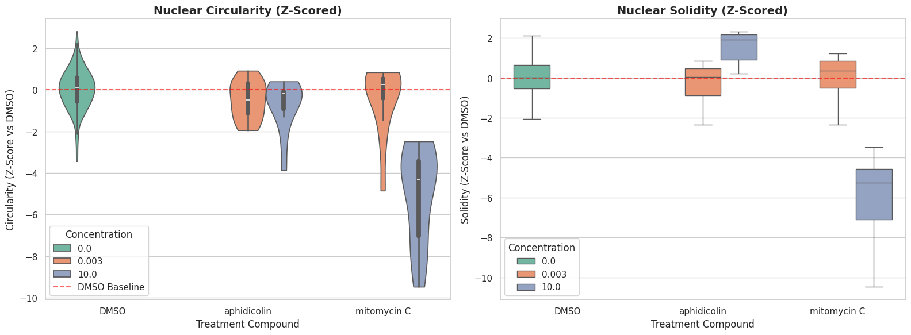
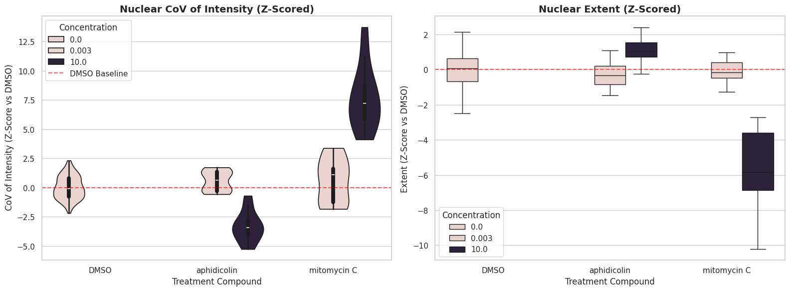
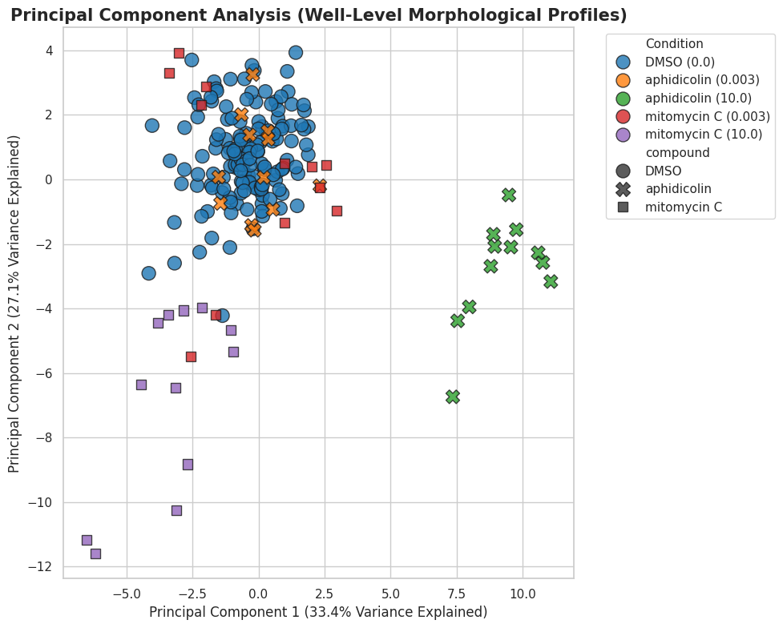

# Morphological Profiling of DNA-Damaging Compounds in BBBC021

**Nuclear morphology of MCF-7 breast cancer cells treated with aphidicolin and mitomycin C, quantified from DAPI images in the BBBC021 dataset.**

Course project for **BIO_52101_EP – Sciences des données de l'imagerie biologique** (Data Sciences of Biological Imaging), Institut Polytechnique de Paris.


---

## Overview

High-content microscopy records cell morphology at single-cell resolution, so it can show how drugs change cellular phenotypes. This project asks a focused question:

> **Can image-derived nuclear features tell apart two DNA replication inhibitors that work through different mechanisms, and do the observed phenotypes agree with their known biology?**

| Compound | Mechanism of action | Expected nuclear phenotype |
|---|---|---|
| **Aphidicolin** | Reversibly inhibits DNA polymerases α/δ/ε, stalls replication forks, blocks S phase | Nuclear swelling with evenly distributed chromatin |
| **Mitomycin C (MMC)** | Forms DNA interstrand cross-links that block replication and transcription | Apoptosis: nuclear blebbing and fragmentation, chromatin condensation |

Both compounds were compared with the **DMSO negative control** at a low dose (**0.003 µM**) and a high dose (**10 µM**).

## Dataset

[**BBBC021**](https://bbbc.broadinstitute.org/BBBC021) (Broad Bioimage Benchmark Collection): MCF-7 cells treated for 24 h with 113 compounds at 8 concentrations, imaged in three channels (DNA/DAPI, β-tubulin, F-actin). Only the **DAPI (nucleus) channel** is used here.

| Condition | Plates (biological replicates) | Images |
|---|---|---|
| DMSO (control) | Week1_22123, 22141, 22161 + Week4_27801, 27821, 27861 | 144 |
| Aphidicolin 0.003 µM / 10 µM | Week1_22123, 22141, 22161 | 12 / 12 |
| Mitomycin C 0.003 µM / 10 µM | Week4_27801, 27821, 27861 | 12 / 12 |

Each treated condition has 3 plates × 4 sites = 12 images. In total, **192 images and ~43,000 segmented nuclei** were analysed.

Filename convention, e.g. `Week1_150607_C10_s1_w1<UUID>.tif`: plate/date prefix, well `C10`, site `s1`, channel `w1` (DAPI), then a unique image ID.

## Pipeline

```
BBBC021 metadata ──► 1. Data extraction ──► 2. Nuclear segmentation ──► 3. Feature extraction ──► 4. Plate normalisation ──► 5. Analysis
 (BBBC021_v1_image.csv)  select DAPI images    Cellpose-SAM (cpsam)      scikit-image regionprops   z-score vs DMSO           violin/box plots,
                         per condition/plate   label masks + ImageJ ROIs 20+ features per nucleus   on the same plate         dose-response, PCA,
                                                                                                                              ANOVA + Tukey HSD
```

1. **Data extraction** (`notebooks/01_data_extraction.ipynb`, `scripts/prepare_dataset.py`): filter the BBBC021 metadata by plate, compound and concentration, and copy the matching DAPI images into one folder per condition.
2. **Segmentation**: nuclei were segmented with **Cellpose-SAM** (Cellpose v4, `cpsam` model). The label masks (`*_masks.tif`) and ImageJ ROI sets (`*_rois.zip`) are included in `data/`.
3. **Feature extraction** (`notebooks/02_feature_extraction_and_analysis.ipynb`): per-nucleus `regionprops` features:
   - *Size/shape:* area, perimeter, eccentricity, solidity, extent, major/minor axis, circularity (4πA/P²), aspect ratio, compactness
   - *DAPI intensity:* mean, max, min, std, integrated intensity, range, coefficient of variation
   - *Per-image distribution:* area variance, skewness, kurtosis, % small (<10th pct) and % large (>90th pct) nuclei, cell count
4. **Batch-effect correction**: each image-level profile is z-scored against the **DMSO wells of its own plate**, Z = (X − μ_DMSO) / σ_DMSO, which removes plate-to-plate variation.
5. **Analysis**: violin and box plots, cell-count dose-response, PCA on standardised image-level profiles, and one-way ANOVA with Tukey HSD post-hoc tests (DMSO vs. 10 µM aphidicolin vs. 10 µM MMC, DMSO randomly subsampled to n = 12 images to match the treated groups).

## Key results

### Cell viability: both drugs are dose-dependently cytotoxic
At 10 µM, the mean nuclei count per image falls from **~244 (DMSO)** to **~126 (aphidicolin)** and **~117 (MMC)**, about a 50% reduction.



### Nuclear size: aphidicolin swells the nucleus
High-dose aphidicolin increases mean nuclear area strongly (z ≈ **+9.2**; ~1305 px² vs. ~891 px² for DMSO). MMC barely changes mean area (z ≈ +0.4) but raises area **variance** (z ≈ +3.3), meaning nuclear sizes become heterogeneous.



### Shape: MMC degrades nuclear integrity
High-dose MMC lowers **circularity** and **solidity**, which fits nuclear blebbing and fragmentation. Aphidicolin leaves shape essentially intact.



### Chromatin: condensation (MMC) vs. even expansion (aphidicolin)
MMC increases DAPI intensity heterogeneity (coefficient of variation) and lowers extent, consistent with apoptotic chromatin clumping. Aphidicolin lowers mean intensity and raises extent, i.e. the same DNA spread over a larger, smooth nucleus.



### PCA: the two mechanisms separate along different axes
PC1 (33.4% of variance) separates **10 µM aphidicolin** (nuclear swelling). PC2 (27.1%) separates **10 µM MMC** (texture and shape irregularity). The 0.003 µM treatments overlap with DMSO.



### Statistical validation (one-way ANOVA + Tukey HSD, n = 12 images per group)

| Feature | ANOVA F | p-value | DMSO vs Aph 10 | DMSO vs MMC 10 | Aph 10 vs MMC 10 |
|---|---|---|---|---|---|
| Nuclear area | 141.38 | 6.6 × 10⁻¹⁷ | **+9.16** ✔ | +0.34 (n.s.) | **−8.82** ✔ |
| Area variance | 42.16 | 8.2 × 10⁻¹⁰ | **+4.20** ✔ | **+3.34** ✔ | −0.86 (n.s.) |
| Circularity | 36.27 | 4.7 × 10⁻⁹ | −0.71 (n.s.) | **−4.98** ✔ | **−4.27** ✔ |
| Solidity | 82.79 | 1.4 × 10⁻¹³ | +1.38 (n.s.) | **−6.00** ✔ | **−7.38** ✔ |

Values are Tukey mean differences in z-score units; ✔ = significant at FWER 0.05.

## Conclusion

- Nuclear features alone separate both DNA-damaging agents from the control and from each other.
- **Aphidicolin → nuclear swelling** (size increases, shape preserved), consistent with S-phase arrest under replication stress.
- **Mitomycin C → structural degradation** (lower circularity and solidity, heterogeneous chromatin), consistent with apoptosis-associated blebbing and fragmentation.
- Both are dose-dependent growth inhibitors, but the image-derived phenotypes reflect their different mechanisms, in line with the literature.

## Repository structure

```
├── notebooks/
│   ├── 01_data_extraction.ipynb               # select & copy DAPI images per condition from BBBC021
│   └── 02_feature_extraction_and_analysis.ipynb  # features, z-scoring, plots, PCA, ANOVA/Tukey
├── scripts/
│   └── prepare_dataset.py                     # reproducible version of notebook 01
├── data/
│   ├── metadata/BBBC021_v1_image.csv          # official BBBC021 image metadata
│   ├── DMSO/<plate>/                          # Cellpose-SAM masks (*_masks.tif) + ImageJ ROIs (*_rois.zip)
│   ├── aphidicolin/concentration_{0003,10}/<plate>/
│   └── mitomycin/concentration_{0003,10}/<plate>/
├── results/
│   ├── bbbc021_extracted_features.csv         # image-level morphological profiles (192 × 30)
│   ├── bbbc021_zscored_features_per_plate.csv # same, z-scored vs DMSO per plate
│   └── figures/
├── docs/
│   ├── project_proposal.pdf
│   └── presentation.pdf
└── requirements.txt
```

> **Raw images are not committed** (~500 MB of public data). Run `scripts/prepare_dataset.py` to place them next to the masks; see below. (ROI zips for aphidicolin 0.003 µM, plate Week1_22141 were not exported; the label masks are present for every image.)

## Reproducing the analysis

```bash
pip install -r requirements.txt

# 1. Download the 6 plates listed above from https://bbbc.broadinstitute.org/BBBC021 and unzip them
python scripts/prepare_dataset.py --bbbc021-root /path/to/BBBC021

# 2. Open notebooks/02_feature_extraction_and_analysis.ipynb and set
#    base_dir = "<path to this repo>/data"
#    (the notebook was originally run on Google Colab from Google Drive)
```

To analyse only the pre-computed features, skip step 1 and load the CSVs in `results/`.

## References

- Ljosa V. et al. (2013). Comparison of methods for image-based profiling of cellular morphological responses to small-molecule treatment. *J Biomol Screen* 18(10):1321–1329.
- Caie P.D. et al. (2010). High-content phenotypic profiling of drug response signatures across distinct cancer cells. *Mol Cancer Ther* 9(6):1913–1926.
- Pachitariu M., Rariden M., Stringer C. (2025). Cellpose-SAM: superhuman generalization for cellular segmentation. *bioRxiv*.
- Krokan H., Wist E., Krokan R.H. (1981). Aphidicolin inhibits DNA synthesis by DNA polymerase α and isolated nuclei by a similar mechanism. *Nucleic Acids Res* 9(18):4709–4719.
- Verweij J., Pinedo H.M. (1990). Mitomycin C: mechanism of action, usefulness and limitations. *Anti-Cancer Drugs* 1(1):5–13.
- Vesela E. et al. (2017). Common chemical inductors of replication stress: focus on cell-based studies. *Biomolecules* 7(1):19.
- Recolin B. et al. (2014). Molecular mechanisms of DNA replication checkpoint activation. *Genes* 5(1):147–175.
- Ma L. (2005). Apoptosis of human gastric cancer SGC-7901 cells induced by mitomycin combined with sulindac. *World J Gastroenterol* 11(12):1829.
- Funkhouser C.M. et al. (2013). Mechanical model of blebbing in nuclear lamin meshworks. *PNAS* 110(9):3248–3253.

Dataset: *We used image set BBBC021v1 [Caie et al., Molecular Cancer Therapeutics, 2010], available from the Broad Bioimage Benchmark Collection [Ljosa et al., Nature Methods, 2012].*
